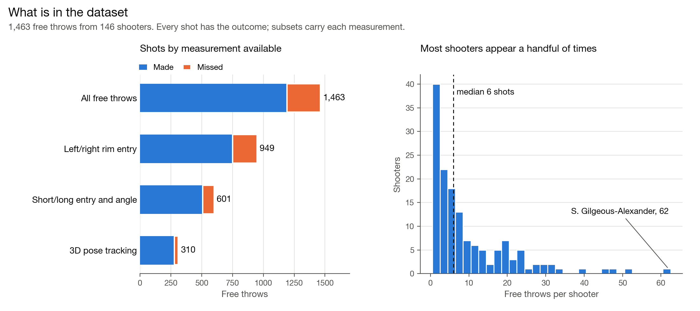
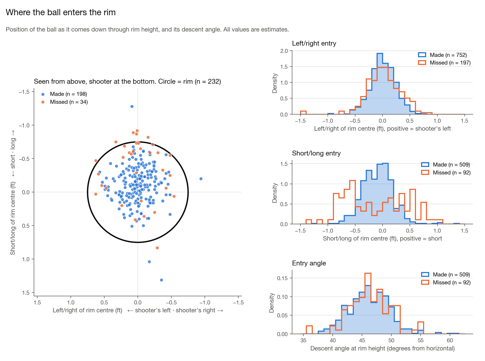
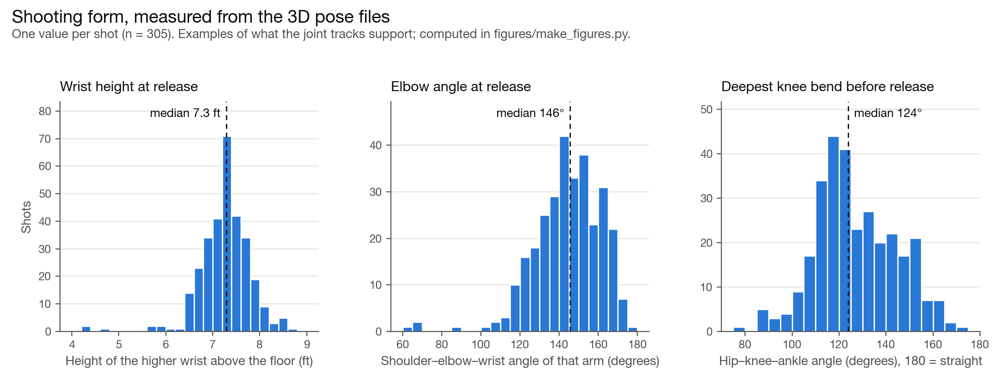

# Free Throw Open Data

Independently generated, video-derived estimates of free-throw biomechanics and shot-entry characteristics from the
2026 NBA Playoffs: where the ball entered the rim, and 3D body tracking of the shooter through the shooting motion.

> **Not affiliated with the NBA.** This is an independent project. It is not affiliated with, endorsed by, sponsored
> by, or produced in association with the National Basketball Association, its teams, or its players. It is not
> official NBA data. Team and player names are used only to identify the shots described.

All values are estimates. They are not sensor measurements and carry estimation error.

## Contents

| path | what |
|---|---|
| `data/free_throws.csv` | one row per free throw (1,463 shots, 146 shooters, 81 games) |
| `data/pose/<shot_id>.json` | 3D joint tracking of the shooter for 310 of those shots (82 shooters) |

Not every shot has every measurement: 949 have a left/right rim entry, 601 have a short/long rim entry and entry
angle, and 310 have pose tracking. Blank cells mean "not measured".

## A look at the data







The figures are drawn from the files in `data/` by [`figures/make_figures.py`](figures/make_figures.py)
(`pip install numpy matplotlib`). The shooting-form measures are examples computed from the joint tracks, not
columns in the dataset.

## `free_throws.csv`

| column | meaning |
|---|---|
| `shot_id` | identifier used across this dataset (`FT0001`...) |
| `season`, `round`, `game_number`, `matchup`, `game` | which game; `matchup` lists the two teams alphabetically |
| `home_team` | home team, blank where not recorded |
| `period`, `clock` | period and game clock (`MM:SS`) of the free throw |
| `player`, `team` | shooter and their team |
| `attempt`, `of_attempts` | e.g. 1 of 2 |
| `made` | 1 made, 0 missed |
| `entry_lr_ft` | left/right position of the ball where it came down through rim height, in feet from the rim centre. Positive is the shooter's left |
| `entry_sl_ft` | short/long position at the same instant, in feet from the rim centre. Positive is short, negative is long |
| `entry_angle_deg` | descent angle of the ball at rim height, in degrees from horizontal |
| `entry_flag_ambiguous` | 1 if the entry reading could not be separated from the other free throw of the same trip, so it may belong to that one |
| `entry_flag_calibration` | 1 if the rim location behind the reading was lower confidence |
| `has_pose` | 1 if `data/pose/<shot_id>.json` exists |

## Pose files

```json
{
  "shot_id": "FT0003",
  "player": "O. Anunoby", "team": "NYK",
  "game": "2026 NBA Playoffs, Round 1 Game 1, ATL-NYK",
  "period": 1, "clock": "02:29", "attempt": 1, "of_attempts": 2, "result": "made",
  "units": "ft", "fps": 29.97, "n_frames": 136, "n_gap_filled_frames": 7,
  "segment_lengths_ft": {"L_UPPER_ARM": 1.217, "...": 0},
  "tracking": [
    {"frame": -90, "time": -3.003, "data": {"NOSE": [0.144, 14.082, 5.321], "...": []}}
  ]
}
```

- **Time.** `frame` 0 and `time` 0 are the release. Negative values are before it. `time` is in seconds.
- **Coordinates.** Feet, `[x, y, z]`, relative to the basket being shot at. The origin is on the floor directly
  under the centre of the rim, so the rim centre is `(0, 0, 10)`. `y` points from the basket toward the shooter
  (the free throw line is at `y = 13.75`), `z` is up, and positive `x` is the shooter's left as they face the basket.
- **Joints.** `NOSE`, `L_EYE`, `R_EYE`, `L_EAR`, `R_EAR`, `L_SHOULDER`, `R_SHOULDER`, `L_ELBOW`, `R_ELBOW`,
  `L_WRIST`, `R_WRIST`, `L_HIP`, `R_HIP`, `L_KNEE`, `R_KNEE`, `L_ANKLE`, `R_ANKLE`. A joint that was not resolved
  in a frame is left out of that frame's `data`.
- **`segment_lengths_ft`.** One fitted length per body segment for the shot.
- **`n_gap_filled_frames`.** Number of frames in which the body position was interpolated by a model rather than
  measured directly.

## Known limits

- 23 pose files skip some frames (up to 31), so do not assume consecutive frame numbers.
- About 0.2% of joint positions (1,389 points across 32 shots) sit far from the shooter's body: more than 5 ft from
  the shot's median hip position, or outside -1 to 10.5 ft in height. Filter these before use.
- Face joints are resolved less often than body joints.
- The ball is not tracked in the pose files.
- Shots are a subset of all playoff free throws, chosen by what could be measured, not at random.

## Licence

The dataset in this repository is released under the
[Creative Commons Attribution 4.0 International licence](LICENSE) (CC BY 4.0). You may use, share and adapt it,
provided you give credit.

The licence covers only this dataset and its documentation. It grants no rights in any game footage or broadcast,
or in any names, logos or trademarks of the NBA, its teams or its players.
